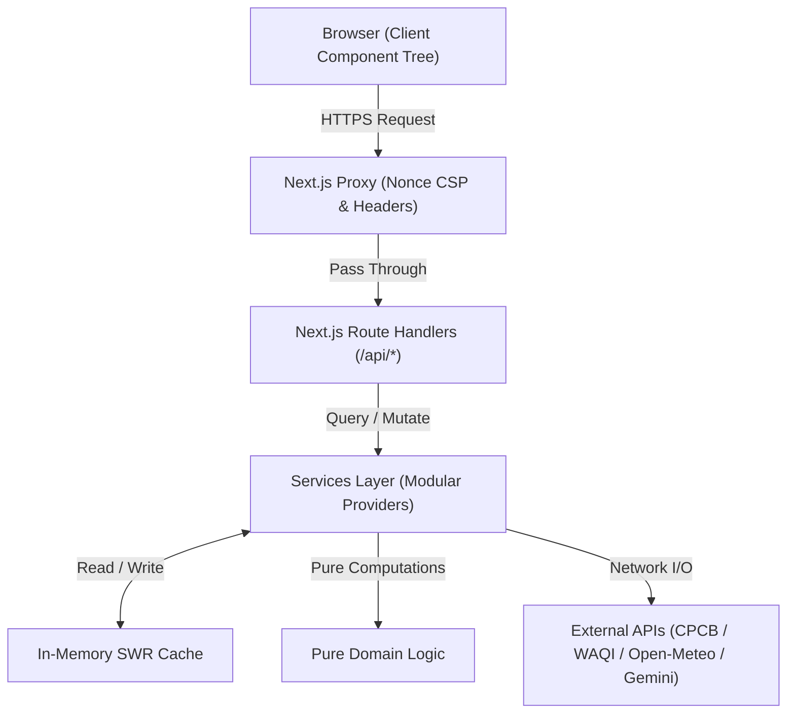
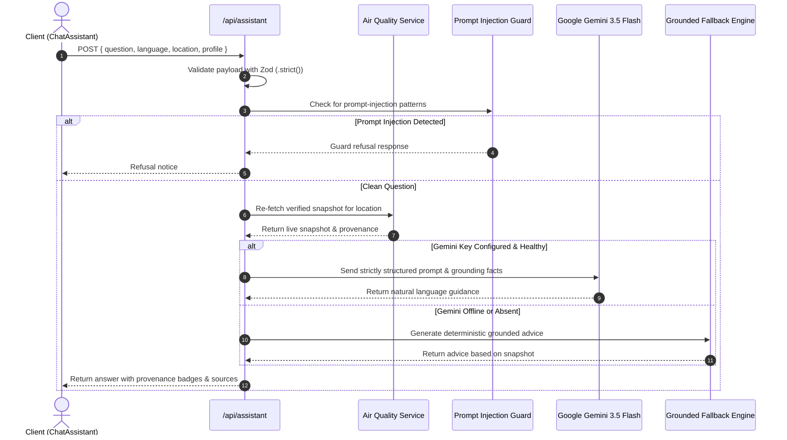

# Architecture & System Design

This document details the high-level architecture, module decomposition, and data flow of **UrbanAir (Saaf Hawa)**.

---

## 1. System Overview

---

## 2. Request Lifecycle & GenAI Grounding

UrbanAir integrates Generative AI strictly as an **explanation layer**, avoiding hallucinations through mandatory server-side data grounding:

---

## 3. Modular Service Architecture

Following the refactoring, every major service is split into dedicated, single-responsibility files under its own subdirectory:

### Geocoding Service (`src/services/geocode/`)
- `types.ts`: Type contracts (`Place`).
- `schemas.ts`: Zod parsing schemas for Open-Meteo and BigDataCloud.
- `defaultCities.ts`: 30-city offline fallback database.
- `searchPlaces.ts`: Forward place search with cache and offline fallback.
- `reverseGeocode.ts`: Coordinate-to-location reverse resolution.
- `resolveLocation.ts`: Normalization orchestrator.
- `index.ts`: Barrel export.

### Grounded Assistant Service (`src/services/assistant/`)
- `types.ts`: Payload and response interfaces.
- `facts.ts`: Verified facts extraction from air quality snapshots.
- `prompts.ts`: System prompt construction and leakage defense.
- `geminiClient.ts`: SDK-free fetch integration with schema parsing.
- `groundedFallback.ts`: Deterministic answer generation when LLM is offline.
- `sources.ts`: Authoritative citation mapping.
- `index.ts`: Orchestration controller.

### Weather Service (`src/services/weather/`)
- `types.ts`: Provider interfaces.
- `openMeteo.ts`: Open-Meteo atmospheric forecast adapter.
- `openWeather.ts`: OpenWeatherMap forecast adapter.
- `index.ts`: Resilience provider cascade.

### Component Sub-packages
- `src/components/chat/`: `ChatMessageItem`, `ChatMessageList`, `SuggestionChips`, `types`.
- `src/components/impact/`: `Metric`, `EstimateCard`, `AssumptionsDetails`, `constants`.
- `src/components/location/`: `LocationSearchResults`, `types`.
- `src/components/SampleDataBanner.tsx`: Independent alerting component.
